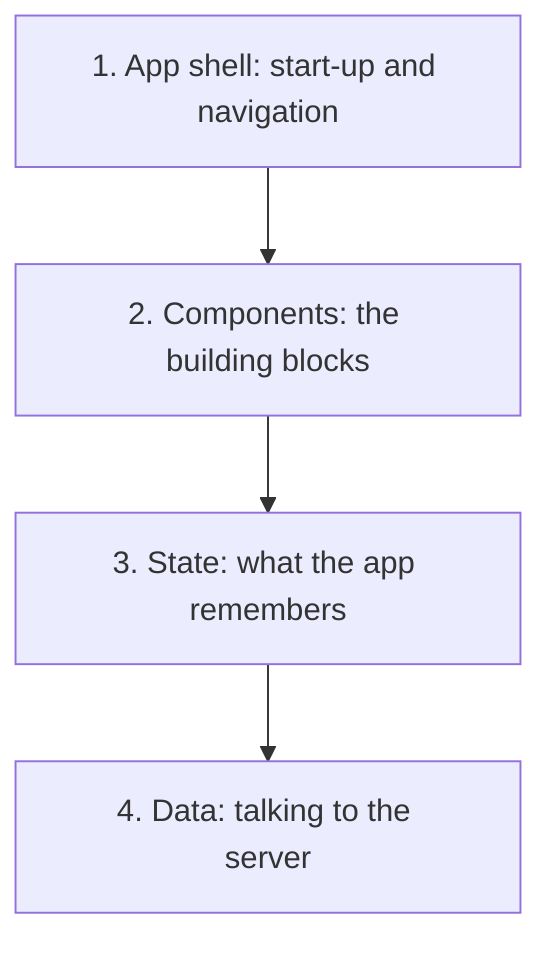

# Frontend System Design

Forge · Session 1 · Theory only

<!--
Welcome. Today is mental models, no code.
Rule for the room: ask "what does that mean?" any time.
-->

---

# Today's goal

By the end you can:

- Say what "frontend system design" means in plain words
- Name the four layers of a frontend app
- Start any design problem the right way

<!--
Beginner note: system design = deciding how the parts of a big app fit together
before you build it. Like drawing a house plan before laying bricks.
-->

---

# Coding vs designing

| Coding | System design |
| --- | --- |
| "Build this button" | "How should the whole app be organised?" |
| One right answer | Many valid answers |
| Is it correct? | Is it a good trade-off? |

<!--
Key idea: there's rarely a perfect answer, only a choice with a cost.
Ask the room: have you ever picked a tool and later regretted it? That's a trade-off.
-->

---

# What is "frontend" here?

Everything that runs in the user's browser or phone:

- What the user sees
- How it reacts to clicks and typing
- How it talks to the server

<!--
Frontend design is NOT picking colours. It's how the app stays fast, reliable,
and easy for many developers to change.
-->

---

# The four layers

<!--
Walk top to bottom. Analogy: a restaurant.
Shell = the building and doors. Components = tables, menus, plates.
State = the waiter remembering your order. Data = the kitchen.
-->

---

# Layer 1: App shell

- What loads first when someone opens the app
- How moving between pages works
- How links and the back button behave

Why it matters: it decides how fast the app *feels* at the start.

---

# Layer 2: Components

- Small reusable pieces: button, card, menu
- Combined into bigger screens
- Goal: change one piece without breaking others

<!--
Analogy: Lego bricks. Good bricks fit many builds.
-->

---

# Layer 3: State

State = what the app remembers right now.

- **Client state:** is the menu open? what did I type?
- **Server state:** my profile, my orders (the server is the boss)

Mixing these up is a classic source of bugs.

<!--
Beginner example: a shopping cart. The "cart drawer is open" is client state.
The items in your cart are server state.
-->

---

# Layer 4: Data

- Asking the server for information
- Handling slow replies and failures
- Storing answers so we don't ask twice (caching)

<!--
We go deep on this in Session 3. Today just know it exists.
-->

---

# How to start any design

1. **Clarify:** who are the users? how many? what devices?
2. **List requirements:** what it must do, and how well
3. **Sketch the layers**
4. **Pick 2 or 3 big decisions and explain the trade-off**

<!--
The big lesson: don't jump to tools. Ask questions first.
Ask the room: if I say "design a news app", what would you ask me first?
-->

---

# Two kinds of requirements

| What it does | How well it does it |
| --- | --- |
| Read articles | Loads in about 2 seconds on a phone |
| Save favourites | Still works if one service fails |
| Search | Usable with a screen reader |

The second column drives the architecture most.

---

# Trade-offs in one line

Every choice gives you something and costs you something.

> Say: "I chose X because of Y, and the cost is Z."

<!--
Practise out loud: pick any tool you use and say that sentence about it.
-->

---

# Homework thought

You're designing a **news website**.

What 3 questions would you ask before drawing anything?

We'll start Session 2 with your answers.

---
layout: center
class: text-center
---

# Questions?

Source inspiration: System Design Handbook, "Frontend System Design" guide.
These slides are our own words.

Forge · join, learn, build