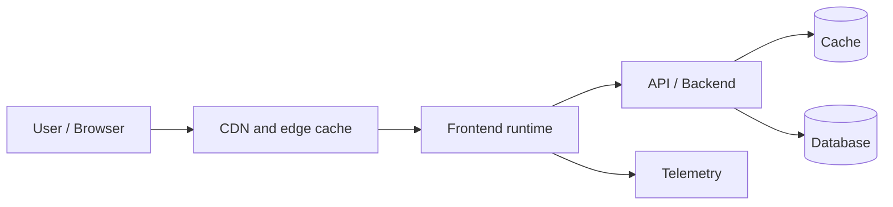
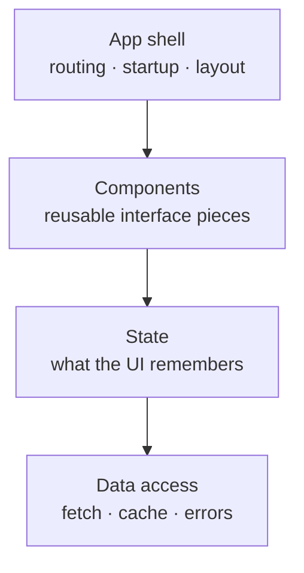
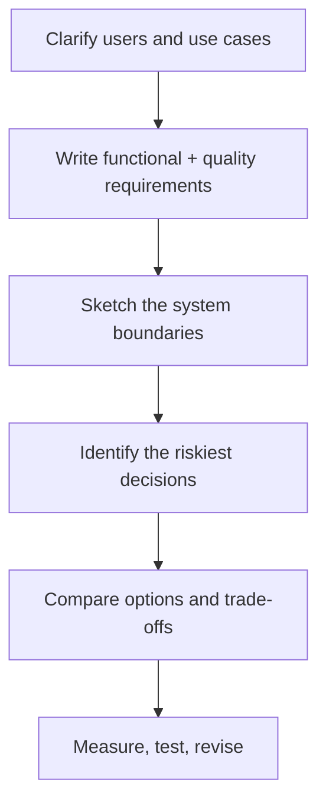

Forge Community · Engineering Systems Series

# Frontend System Design

## From individual screens to dependable products

Session 01 · Foundations · Theory + discussion

<!--
Facilitator: tell learners that system design is not about guessing a perfect stack.
It is about making explicit decisions under constraints. Invite questions at any time.
-->

---
layout: two-cols
---

# The goal is not more boxes

A strong frontend system should help a product:

- deliver useful content quickly
- remain understandable as features grow
- handle slow networks and failed services
- let multiple engineers work safely
- protect users and their data

::right::

### The engineer's job

**Translate product needs into technical choices.**

A diagram is useful only when it helps us explain a decision, a risk, or a boundary.

---

# Coding vs system design

| Coding task | System-design question |
|---|---|
| Build a search input | How does search stay responsive with 100,000 results? |
| Fetch a profile | What happens when the API is slow or unavailable? |
| Add a route | Which pages need search indexing or personalized data? |
| Reuse a card | How do shared components evolve without breaking teams? |

<!--
Ask: which column do you spend more time thinking about today? Neither skill replaces the other.
-->

---

# A frontend is part of a larger system

The browser is only one part of the request path. A slow screen can be caused by code, network, API, cache, or database.

<!--
Walk left to right. Keep the diagram high-level; later sessions zoom into rendering, data, performance, and security.
-->

---

# Four frontend responsibilities

These are **responsibilities**, not necessarily four folders. A small app may keep them close; a larger app benefits from clearer boundaries.

---

# Start with requirements, not libraries

**Functional:** what the product must do.

- browse articles
- search and filter
- save an article
- sign in

**Non-functional:** how well it must work.

- usable on low-end phones
- accessible by keyboard
- search engines can discover articles
- core reading works when recommendations fail

The non-functional requirements often determine the architecture.

---

# Make requirements measurable

| Vague requirement | Better question |
|---|---|
| Fast | What is the target for main content on a typical mobile connection? |
| Scalable | What traffic spike do we expect, and which resource becomes the bottleneck? |
| Reliable | Which features must continue when a dependency fails? |
| Secure | What data is sensitive, and where are the trust boundaries? |

Do not invent targets just to fill a slide. Record assumptions and validate them.

---

# A repeatable design method

**Interview habit:** state your assumptions out loud before recommending a technology.

---

# Worked example: a news app

Assumptions to validate:

- most readers use mobile devices
- public articles should be discoverable by search engines
- comments change more often than article text
- the site may receive sudden traffic during breaking news
- saved articles are private to each account

These assumptions already suggest that different parts of one product may need different strategies.

---

# One choice, one benefit, one cost

> “I would use static or cached delivery for article content because fast public reading matters. The cost is freshness complexity; breaking-news content needs a shorter refresh path.”

A good answer includes:
- **why** the requirement matters
- **what** you chose
- **what it costs**
- **when** you would reconsider

---

# Discussion challenge

Design the first version of a news site.

1. What three questions would you ask the product owner?
2. Which requirement matters most on a low-end phone?
3. What should still work if recommendations are unavailable?
4. Which assumption would you measure first?

Next: rendering strategies — where and when the page is built.

---
layout: center
class: text-center
---

Forge Community

# Think in systems.

Build with intent. Measure the result.
