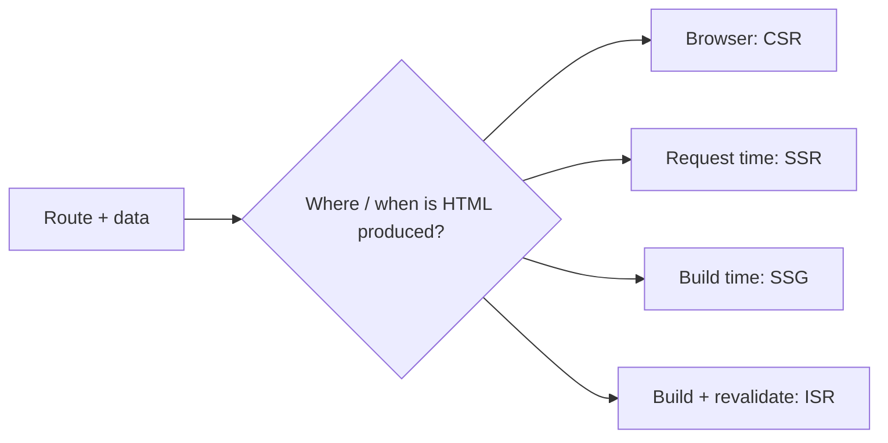
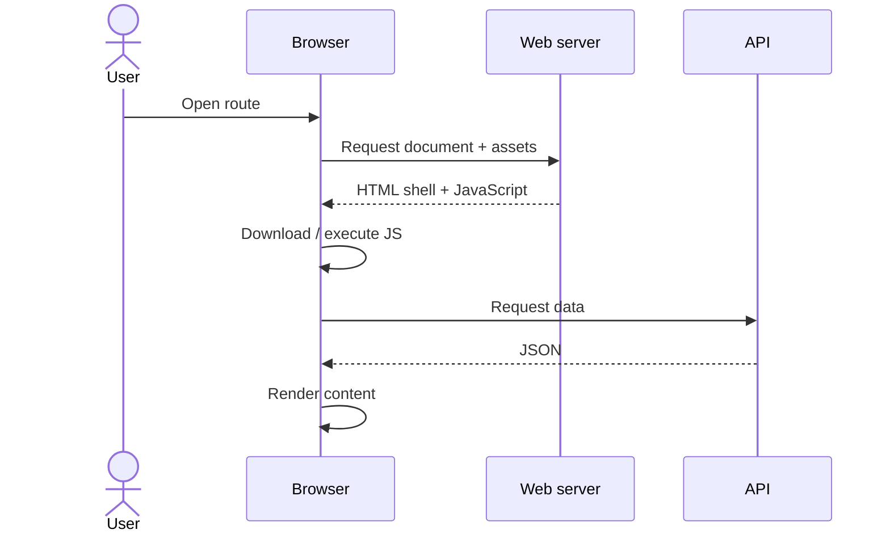
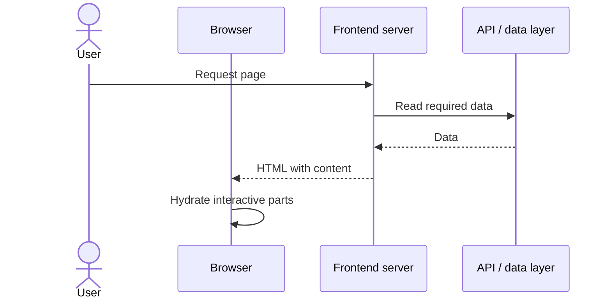
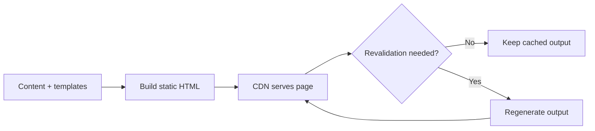

Session 02 · Rendering

# Where should the page be built?

## Rendering is a product and infrastructure decision

CSR · SSR · Static generation · ISR · Hybrid

---

# The question behind rendering

Rendering turns code and data into the interface users see.

The choice affects first content, personalization, freshness, server work, and caching.

---

# CSR: the browser builds the page

**Fits:** highly interactive authenticated dashboards where SEO is not the main goal.

**Costs:** large JavaScript bundles and chained requests can delay useful content, especially on low-end devices.

---

# SSR: the server renders per request

**Fits:** personalized or frequently changing pages where server-rendered content improves the initial experience.

**Costs:** request-time compute, data latency, and hydration work. HTML can appear before every interactive feature is ready.

---

# SSG and ISR: prepare content ahead

- **SSG:** output is generated ahead of requests.
- **ISR:** supported frameworks can regenerate static output after a configured interval or trigger.
- **Benefit:** fast delivery and efficient CDN caching.
- **Cost:** content may be stale until regeneration completes.

Framework semantics differ; verify the actual invalidation and fallback behavior.

---

# Compare the options

| Strategy | Strong fit | Main cost / risk |
|---|---|---|
| CSR | Private, highly interactive screens | JS cost; content may appear late |
| SSR | Personalized or request-fresh content | Compute and data latency per request |
| SSG | Stable public content | Rebuild or invalidation needed |
| ISR | Public content that changes periodically | Bounded staleness and revalidation complexity |

No strategy is universally fastest. Measure the full route and its data dependencies.

---

# Choose per route, not per company

**News product example**

- Home page: static or revalidated feed shell
- Article body: static / revalidated when publication permits
- Breaking banner: short cache or push update
- Comments: client-fetched, with loading and failure states
- Saved articles: authenticated, user-specific data

Hybrid rendering is powerful, but it adds operational complexity and more cache rules to understand.

---

# Hydration: HTML is not the whole story

Server-rendered HTML can make content visible early. Hydration attaches client-side behavior to the rendered markup.

A page can look ready before it is fully interactive. Track both visual loading and responsiveness.

---

# Decision framework

Ask in this order:

1. Does the route need public search discovery?
2. Does its HTML vary by user or request?
3. How fresh must the content be?
4. Can it be cached safely at a CDN?
5. What does rendering and hydration cost on target devices?

Then test the chosen route under realistic network and device conditions.

---

# Production scenario: product inventory

A product page is public, but inventory changes frequently.

**Possible design:** render stable product information statically or with revalidation; fetch or refresh inventory through a suitably fresh data path.

**Trade-off:** fast product content versus the risk of displaying outdated availability. Checkout must validate stock authoritatively on the server regardless of what the page shows.

---

# Your turn: defend the decision

For each route, pick a strategy and explain the cost:

- a marketing landing page
- a private analytics dashboard
- a product detail page with changing stock
- a user-specific account page

Next: state ownership, request waterfalls, caching, and data freshness.

---
layout: center
class: text-center
---

Forge Community

# Choose the rendering strategy that fits the route.
