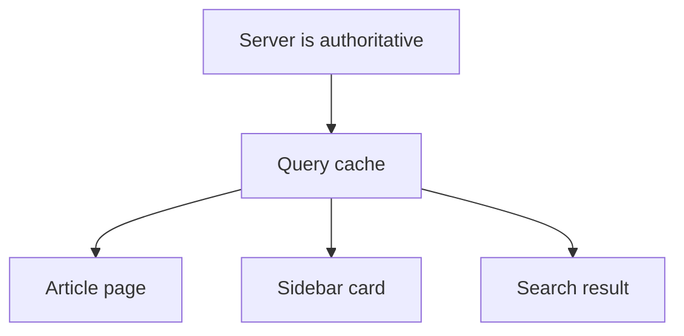
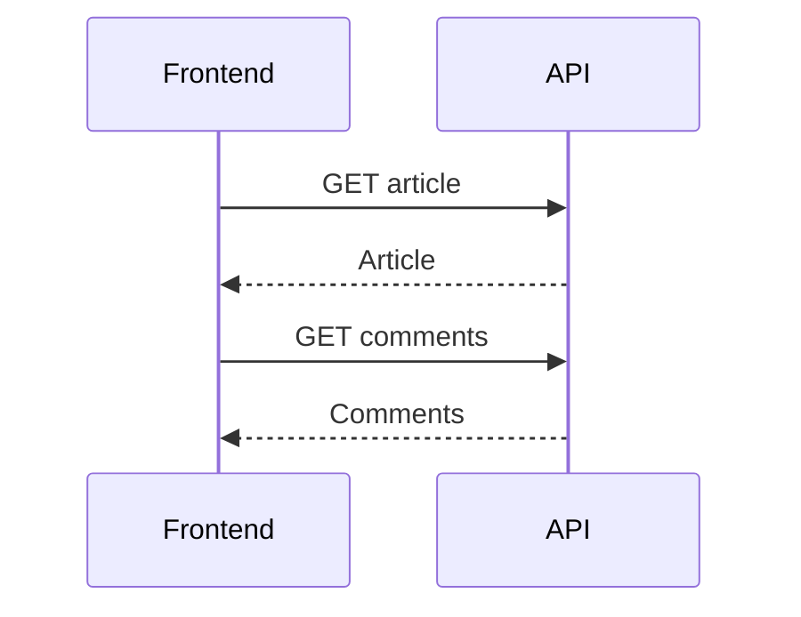
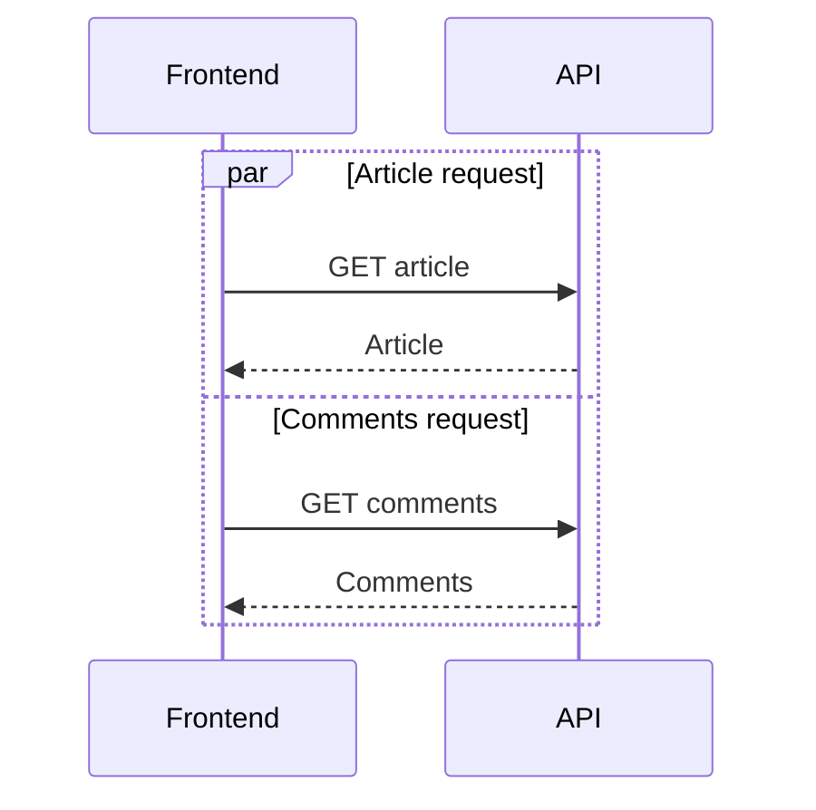
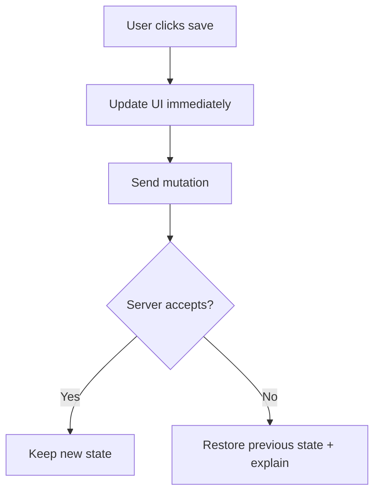

<div class="forge-kicker">Session 03 · State and data</div>

# What does the app remember?

## State ownership, network requests, and cache freshness

<div class="forge-muted">Fast interfaces are designed around data lifecycles, not just API calls.</div>

---

# State is not all the same

| State type | Examples | Typical home |
|---|---|---|
| Local UI state | menu open, current input | Component |
| Shared client state | theme, multi-step workflow | Shared store when needed |
| Server state | profile, orders, article data | API + query/cache layer |
| URL state | search term, sort, page number | URL query parameters |

Rule of thumb: keep state as close as possible to where it is used. Share it only when there is a real sharing need.

---

# Avoid duplicate sources of truth



If every screen maintains an independent copy, they can disagree.

Treat cached server data as a useful copy with a lifecycle: loading, fresh, stale, refreshing, error.

---

# A waterfall wastes time



If comments do not depend on the article response, the second request should not have to wait for the first.

---

# Start independent requests together



**Why it helps:** removes avoidable sequential waiting.

**Caution:** do not parallelize requests that genuinely depend on earlier results; extra concurrency can also increase load.

---

# Caching: what are we promising?

A cache can improve latency and reduce backend work, but it is a promise about reuse and freshness.

| Data | Possible policy | Risk to consider |
|---|---|---|
| Published article | Longer cache | Recently edited content may lag |
| Comment count | Short cache | Count can briefly be old |
| Personal saved list | User-scoped cache | Cross-user leakage if keys are wrong |
| Bank balance / inventory at checkout | Authoritative validation | Stale display must not authorize a transaction |

Never treat a cached frontend value as authorization or as the final source of truth for a critical action.

---

# Cache keys and invalidation

A cache key must represent every input that changes the response.

```text
article:{articleId}:{locale}
profile:{tenantId}:{userId}
search:{query}:{sort}:{page}
```

- Include relevant identity, tenant, locale, and filter dimensions.
- Invalidate or revalidate when source data changes.
- Avoid caching private responses in a shared cache.
- Test both fresh and stale paths.

**Trade-off:** longer cache life often improves speed and cost, but makes freshness harder.

---

# Optimistic updates need a rollback plan

A user clicks “save article”.



Optimistic UI improves perceived speed. It also requires rollback, duplicate-submit protection, and conflict handling.

---

# Real-time updates: choose the simplest fit

| Method | Use when | Cost |
|---|---|---|
| Polling | Small delay is acceptable | Repeated requests |
| Server-sent events | Server streams one-way updates | Connection management |
| WebSockets | Frequent two-way interaction | More operational complexity |

Chat, dashboards, notifications, and collaborative editing have different latency and scale requirements. Do not choose WebSockets just because a product says “real-time.”

---

# Errors are part of the data model

A robust component distinguishes:

- loading
- successful data
- empty result
- stale data while refreshing
- recoverable failure
- permission or validation failure

A failed recommendations widget should not prevent a reader from seeing the article. Retry transient failures carefully; do not retry every error forever.

---

# Production review checklist

Before shipping a data-driven feature, ask:

1. Who owns the authoritative data?
2. Which inputs belong in the cache key?
3. How stale can the result safely be?
4. What happens if a request is slow or fails?
5. Can repeated clicks create duplicate mutations?
6. How will we observe errors and latency?

---

# Challenge: the news feed

Design data behavior for:

- article body
- comments
- breaking-news banner
- saved-article button

For each, state the owner, freshness target, cache approach, and failure behavior. Explain one trade-off.

<div class="forge-muted">Next: measure performance, contain failures, and scale the codebase.</div>

---
layout: center
class: text-center
---

<div class="forge-kicker">Forge Community</div>

# Freshness is a design choice.
