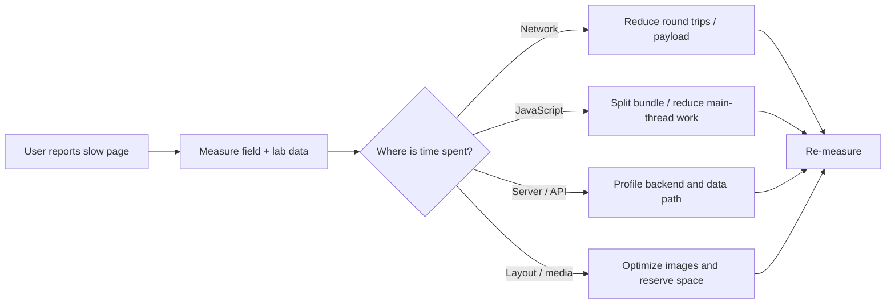
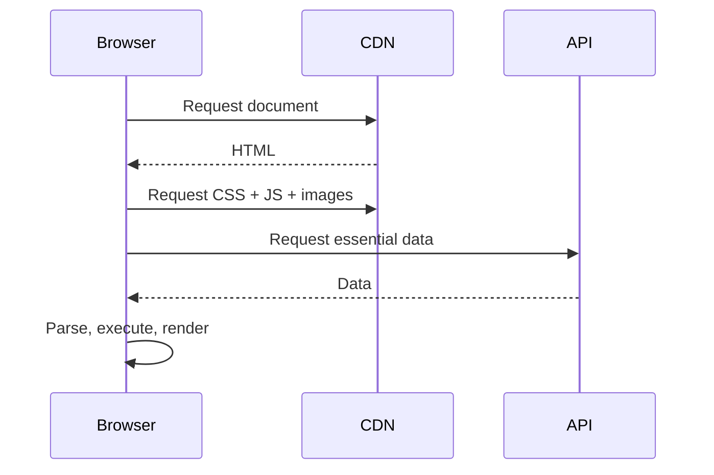
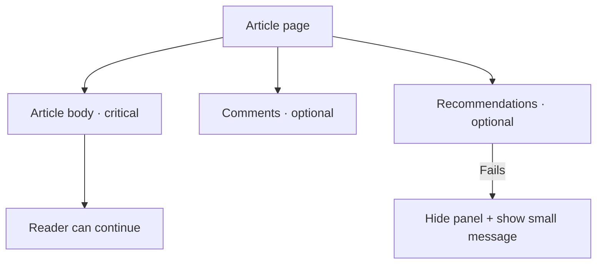

Session 04 · Performance and reliability

# Fast is a system property

## Measure the bottleneck. Protect the critical path.

User experience · browser work · network · services · teams

---

# What users actually feel

| Metric | What it tells us | Good starting target |
|---|---|---|
| LCP | When the main content appears | ≤ 2.5 seconds |
| INP | Responsiveness to interactions | ≤ 200 ms |
| CLS | Unexpected layout movement | ≤ 0.1 |

These are Core Web Vitals “good” thresholds at the 75th percentile. Use field data where available and test representative devices and networks.

---

# Diagnose before optimizing

An optimization is a hypothesis. Capture a baseline, change one major variable, then measure again.

---

# The first-load critical path

Common improvements:
- reduce unnecessary JavaScript and split by route
- avoid dependent request waterfalls
- compress and size images correctly
- defer non-critical content
- cache public assets appropriately

---

# Keep the interface responsive

- Virtualize very long lists when profiling shows rendering cost.
- Debounce expensive search requests where appropriate.
- Move expensive computation off the main thread when justified.
- Avoid layout shifts by reserving space for images and embeds.
- Keep event handlers and component updates efficient.

**Trade-off:** extra optimization machinery increases complexity. Optimize measured bottlenecks, not imaginary ones.

---

# Reliability: contain the blast radius

A resilient UI identifies critical and optional capabilities. Failure in one optional panel should not blank the entire route.

---

# Retry intelligently

Retries help with transient network errors, but can amplify an outage.

- Retry only failures that may recover.
- Use bounded retries and exponential backoff with jitter.
- Respect cancellation when a user leaves the page.
- Avoid retrying validation or permission errors blindly.
- Give the user a clear next step when recovery fails.

For writes, consider idempotency and duplicate-submit protection.

---

# Scale is more than “10,000 users”

A capacity statement needs a workload.

For example, **10,000 requests per minute ≈ 167 requests per second on average**. Actual peak traffic can be much higher, and one request may trigger multiple API or database operations.

Ask:
- What is the peak-to-average ratio?
- What percentage is cacheable?
- What are the latency and error-rate objectives?
- Which resource saturates first?
- What happens when a dependency slows down?

Do not promise capacity without a representative load test.

---

# Scale the team and codebase too

| Technique | Helps with | Cost |
|---|---|---|
| Feature modules with clear contracts | Independent changes | Boundary discipline |
| Shared design system | Consistency and reuse | Governance and versioning |
| Feature flags | Safer gradual rollout | Flag cleanup and test combinations |
| Micro-frontends | Independent delivery by large teams | Runtime, integration, and duplication overhead |

Start with modular boundaries inside one application. Add deployment boundaries only when team and product needs justify them.

---

# Offline behavior is a product decision

Offline support can use cached assets, stored data, and a queued-action strategy.

Before building it, decide:
- which screens must work offline?
- how old may stored data be?
- which actions can safely queue?
- how are conflicts and authentication expiry handled?

Offline capability improves resilience but introduces synchronization and conflict-resolution complexity.

---

# Performance review

For a slow dashboard on a low-end phone:

1. What would you measure first?
2. Which data requests can run in parallel?
3. What could be cached safely?
4. Which UI elements are non-critical?
5. How would you verify the improvement on real devices?

Next: security boundaries, accessibility, and the complete architecture challenge.

---
layout: center
class: text-center
---

Forge Community

# Measure. Isolate. Improve.
