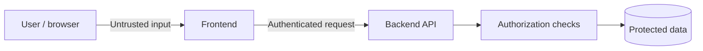
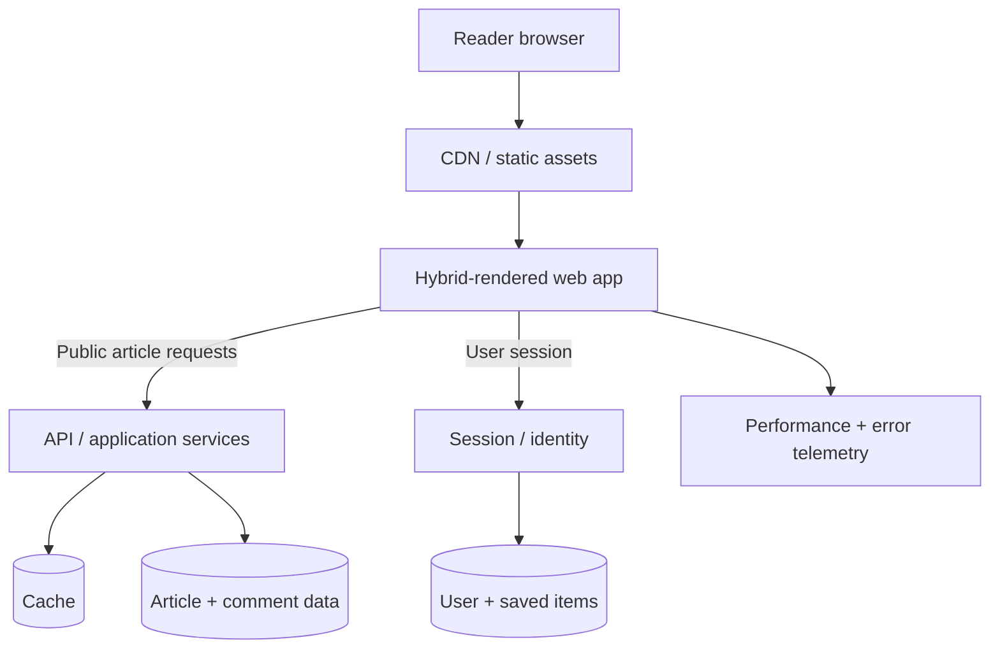

Session 05 · Security and capstone

# Trust is part of the architecture

## Protect users. Include everyone. Make the decisions visible.

Threat boundaries · sessions · accessibility · privacy · worked design

---

# The browser is not a trusted environment

Frontend checks improve the user experience, but the backend must enforce authentication, authorization, and validation.

Never ship private API keys or privileged secrets in client-side bundles.

---

# XSS: untrusted data becomes executable

Cross-site scripting occurs when attacker-controlled content is interpreted as executable code in a trusted page.

Defence in depth:
- use framework-safe text rendering by default
- avoid raw HTML insertion where possible
- sanitize content when rich HTML is a real requirement
- deploy a suitable Content Security Policy
- keep dependencies patched

No single control is a complete guarantee. Review the actual rendering path and threat model.

---

# Session storage: choose with the threat model

| Approach | Benefit | Risk / consideration |
|---|---|---|
| JavaScript-readable storage | Easy for client code to access | XSS can read the token |
| HttpOnly cookie | JavaScript cannot directly read cookie | CSRF protections and cookie settings matter |
| Server-managed session | Centralized revocation and policy | Requires server-side session storage and operations |

Use `Secure`, appropriate `SameSite`, and correct domain/path settings for cookies. HttpOnly reduces token theft through JavaScript; it does not eliminate every XSS or CSRF risk.

---

# Authorization belongs on the server

A hidden admin button is not access control.

For every protected operation:
1. authenticate the caller
2. authorize the requested action on the server
3. validate all inputs
4. scope data to the correct user or tenant
5. log security-relevant events without leaking secrets

The frontend may hide unavailable actions, but the API must independently reject unauthorized requests.

---

# Accessibility is a quality requirement

Check the interface with:

- semantic HTML and meaningful headings
- keyboard-only navigation
- visible focus and sensible focus order
- labels and useful error messages
- screen-reader announcements for meaningful updates
- sufficient contrast and no color-only signals
- reduced-motion support where appropriate

Accessibility improves usability across devices and contexts. It is easier to build into components than retrofit at the end.

---

# Privacy should shape data collection

- Collect only data needed for a defined purpose.
- Do not load optional tracking before the applicable consent decision.
- Keep personal data out of URLs and logs when possible.
- Define retention, access, and deletion behavior.
- Ensure the product remains understandable when optional analytics are disabled.

Requirements vary by jurisdiction and context; involve qualified privacy and legal review for production products.

---

# Capstone: design a news platform

Assumptions to validate:
- mobile-first readers
- public articles should be searchable
- breaking-news banner should update quickly
- comments may fail without blocking reading
- saved articles are private
- traffic spikes during major events

First, ask questions. Then state requirements and constraints before choosing a stack.

---

# Capstone architecture

This is a conceptual diagram, not a deployment prescription. Add queues, replicas, or separate services only when requirements and measurements justify them.

---

# Route-level decisions

| Feature | Starting approach | Trade-off |
|---|---|---|
| Public article | Static / revalidated when feasible | May briefly show old content |
| Breaking banner | Short cache or push update | More refresh traffic or connection complexity |
| Comments | Separate client data lifecycle | Extra loading/error state |
| Saved articles | Authenticated, user-scoped data | Session and privacy complexity |
| Search | URL-addressable query + API | Indexing and ranking work |

Every choice depends on freshness, traffic, framework capabilities, and product requirements.

---

# Failure and security review

**If recommendations fail:** keep the article readable.

**If comments are slow:** show article content first and expose comment loading state.

**If a save mutation fails:** roll back optimistic state and explain the result.

**If a user changes an ID in the request:** the server still checks ownership.

**If a shared cache is used:** prove that private data cannot cross user or tenant boundaries.

---

# Defend your design

For one architecture decision, explain:

1. the requirement it serves
2. the alternative you rejected
3. the operational or user-facing cost
4. the failure mode you considered
5. the metric or test that would validate it

This is the difference between naming technologies and engineering a system.

---

# The series in one view

| Session | Core skill |
|---|---|
| 1 | Frame the problem and sketch boundaries |
| 2 | Choose rendering by route and requirement |
| 3 | Manage state, requests, and freshness |
| 4 | Measure performance and contain failures |
| 5 | Model trust, access, and the whole product |

**Next step:** implement a thin vertical slice of the news app, measure it, and revisit the decisions with evidence.

---
layout: center
class: text-center
---

Forge Community

# Build with intent.

## Make the trade-off explicit.
