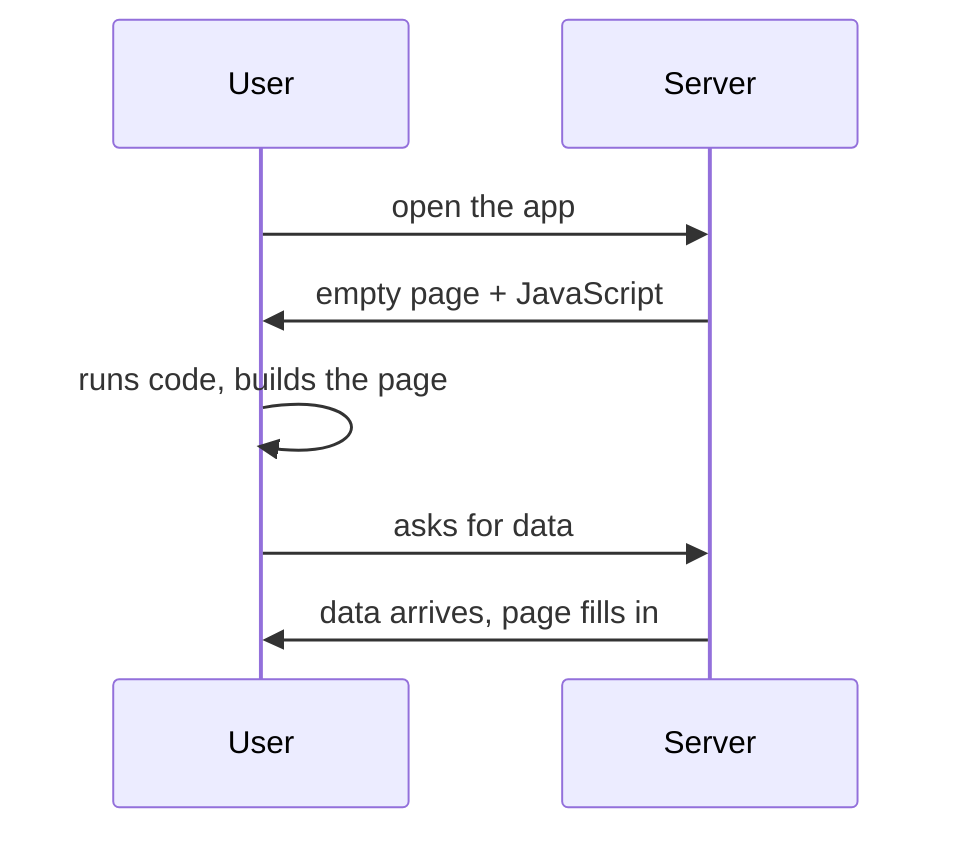
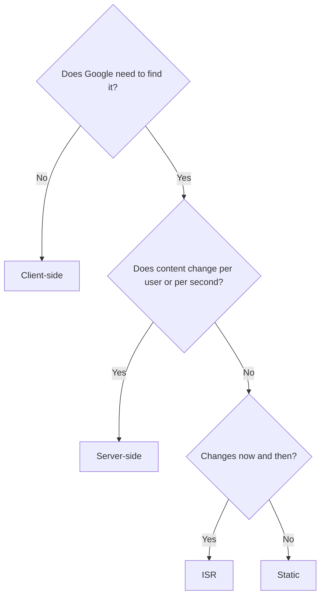

# Rendering Strategies

Forge · Session 2 · Theory only

<!--
Open with the homework: ask 2 or 3 people for their news-site questions.
Good ones: who are the users, do they need Google to find us, how often does content change.
-->

---

# Recap in 30 seconds

- Four layers: shell, components, state, data
- Start with questions, then requirements, then trade-offs

Today: **where does the page get built?**

---

# What is "rendering"?

Rendering = turning code and data into the page you see.

The only question: **who builds it, and when?**

- In the user's browser?
- On our server?
- Ahead of time, before anyone visits?

<!--
Analogy for the whole session: a restaurant.
Client-side = you get ingredients and cook at the table.
Server-side = kitchen cooks when you order.
Static = meals prepared in advance, served instantly.
-->

---

# Option 1: Client-side rendering (CSR)

The browser downloads code, then builds the page itself.

<!--
Beginner note: JavaScript is the instructions the browser follows to build the screen.
-->

---

# CSR: good and bad

| Good | Bad |
| --- | --- |
| Very interactive after loading | Slower first view |
| Simple servers | Heavy code hurts slow phones |
| Great for logged-in dashboards | Weaker for search engines |

Restaurant: cook-at-the-table. Fun, but you wait for the first bite.

---

# Option 2: Server-side rendering (SSR)

The server builds the page, then sends finished HTML.

- User sees content fast
- Search engines read it easily
- Server does more work on every visit

<!--
Trade-off to say out loud: faster for users, costs us more server power and complexity.
Mention hydration simply: after the page appears, JavaScript "wakes it up" so buttons work.
-->

---

# Option 3: Static generation (SSG)

Pages are built **once, ahead of time**, then served from anywhere.

- Extremely fast and cheap
- Perfect for blogs, docs, marketing pages
- Problem: content can go out of date until we rebuild

Restaurant: meals prepared in advance. Instant, but not made-to-order.

---

# Option 4: Incremental static regeneration (ISR)

Static pages that **refresh themselves** every so often in the background.

- Speed of static
- Freshness closer to dynamic
- Cost: a short window where users see slightly old content

<!--
Example: a news category page rebuilt every 60 seconds.
-->

---

# Side by side

| Strategy | Best for | Main cost |
| --- | --- | --- |
| Client-side | Logged-in dashboards | Slow first load, weak SEO |
| Server-side | Public, changing pages | Server load, complexity |
| Static | Blogs, docs | Stale until rebuilt |
| ISR | Frequently updated lists | Brief staleness |

---

# Real apps mix them (hybrid)

An online shop might use:

- **Static** for category pages (fast, found on Google)
- **Server-side** for product pages (live stock)
- **Client-side** for the cart (changes with every click)

The cost: more moving parts to manage.

<!--
Key message: it's not "which is best", it's "which fits each page".
-->

---

# How to choose

<!--
Walk through the news site from the homework together.
Home page, article page, comments, a logged-in "saved articles" page. Choose for each.
-->

---

# Say it like an engineer

> "I'm choosing X because Y matters here. The cost is Z, and if the situation changed to W, I'd consider something else."

Practise with your own project, out loud, once this week.

---

# Homework thought

A news app has: a home page, article pages, a comments section, and a "my saved articles" page.

Pick a rendering strategy for each and give the trade-off.

We'll compare answers at the start of Session 3.

---
layout: center
class: text-center
---

# Questions?

Source inspiration: System Design Handbook, "Frontend System Design" guide.
These slides are our own words.

Forge · join, learn, build