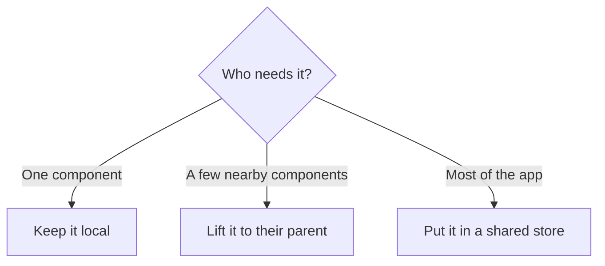
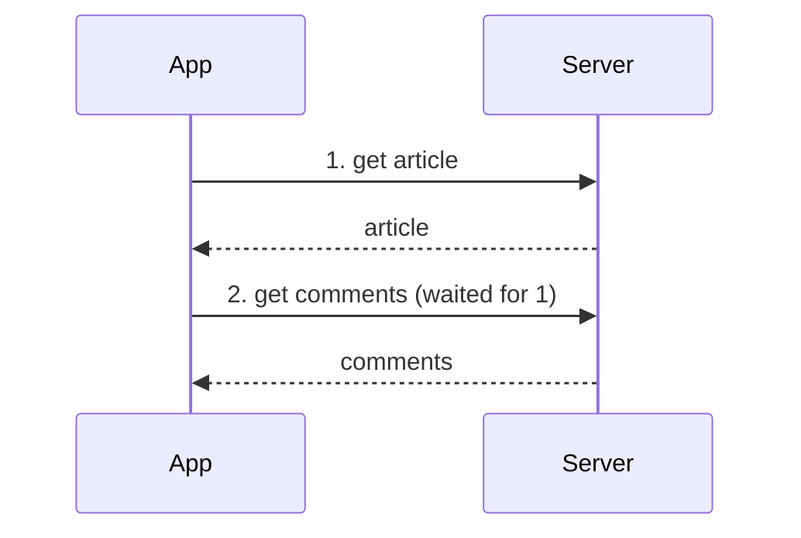
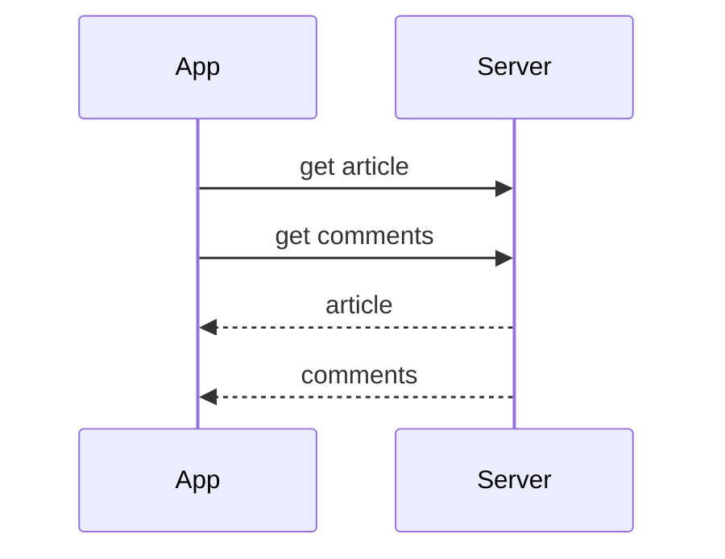

# State, Data and Caching

Forge · Session 3 · Theory only

<!--
Open with the homework: home page, article pages, comments, saved articles.
Take answers from 2 or 3 people before moving on.
Likely good answers: home = ISR or static, article = static or SSR,
comments = client-side, saved articles = client-side (logged in).
-->

---

# Recap in 30 seconds

- Four layers: shell, components, state, data
- Rendering: client, server, static, ISR, or a mix

Today: **what does the app remember, and how does it get fresh data?**

---

# Two kinds of state

| Client state | Server state |
| --- | --- |
| Lives only in the browser | Lives on the server (the boss) |
| Is the menu open? | My profile, my orders |
| Text typed in a form | Articles, prices, stock |
| Throw away anytime | Must stay in sync |

<!--
Analogy: a library. Server state = the books on the shelves (the library owns them).
Client state = the note in your pocket saying which page you're on.
-->

---

# Why mixing them hurts

If you copy server data into many places in the app:

- Different screens show different versions
- You forget to update one copy
- Loading and error states are scattered everywhere

**Treat server data as a borrowed copy that needs refreshing.**

---

# Where should state live?

Rule: keep state as close to where it's used as possible.

<!--
Beginner note: "global" feels convenient but makes bugs harder to find.
Ask the room: where would "is the dark mode on?" live? (Shared, many screens use it.)
-->

---

# Derived state

Some values are just **calculated** from others.

- Cart total = sum of item prices
- "3 unread" = count of unread messages

Calculate them in one place. Don't store separate copies that can disagree.

---

# Getting data: when do we ask?

- **When the page opens:** all data ready before showing
- **When each piece needs it:** page appears earlier, fills in gradually

Danger: **waterfalls**, where one request waits for another before starting.

---

# Fix the waterfall

Ask for independent things **at the same time**.

Same data, less waiting.

---

# Caching: keep a copy nearby

Caching = remembering an answer so we don't ask again.

- Faster for the user
- Less load on the server
- Risk: the copy can go **stale** (out of date)

<!--
Analogy: you photocopy a library page. Quick to reread, but if the book is updated your copy is old.
-->

---

# The caching trade-off

| Approach | Good | Risk |
| --- | --- | --- |
| Cache for a set time | Simple | May show old data until it expires |
| Clear cache when data changes | Precise | Needs careful coordination |
| Show old copy, refresh in background | Feels instant and stays fresh | Brief moment of old data |

That last pattern is called **stale-while-revalidate**.

---

# When freshness matters most

- News headlines: a minute old is fine
- Chat messages: should arrive almost immediately
- Stock count or bank balance: must be accurate

**The more it matters, the less you can cache.**

---

# Updating data: optimistic or careful?

You press "like".

- **Optimistic:** the heart turns red immediately, server confirms later
- **Careful:** wait for the server before changing anything

Optimistic feels fast, but you need a plan if the server says no (undo it).

---

# Live updates

How does the app learn about changes it didn't ask for?

| Method | Plain meaning | Best for |
| --- | --- | --- |
| Polling | Ask every few seconds | Simple, not urgent |
| Server-sent events | Server pushes updates one way | Live feeds |
| WebSockets | Two-way open connection | Chat, collaboration |

Cost: more complex servers as you move down the table.

---

# When things fail

Servers go slow or break. A good app:

- Retries sensibly
- Still shows what it has
- Tells the user clearly what didn't load

A broken "recommended articles" box should **not** stop you reading the article.

---

# Say it like an engineer

> "Comments change often, so I'd fetch them in parallel with the article, show cached ones first, refresh in the background, and accept brief staleness for speed."

Try describing one feature of your own app this way.

---

# Homework thought

For the news app, decide for each:

- Where does each piece of state live?
- How fresh must it be?
- Cache it or not?

Items: article text, comment count, "saved" button, breaking-news banner.

---
layout: center
class: text-center
---

# Questions?

Source inspiration: System Design Handbook, "Frontend System Design" guide.
These slides are our own words.

Forge · join, learn, build
