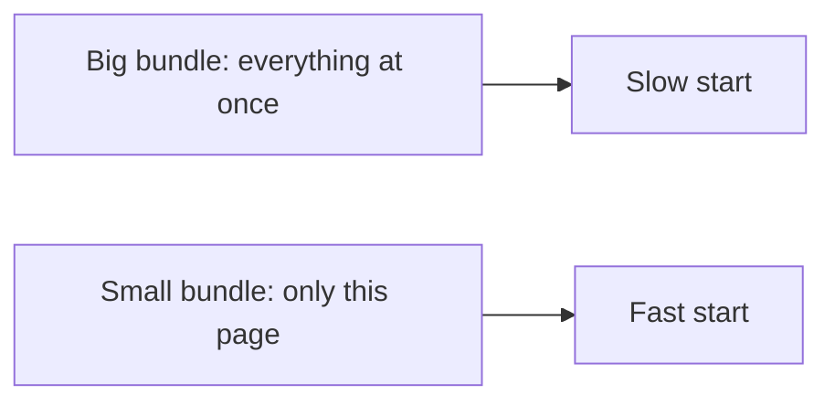
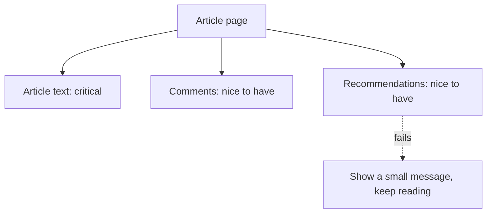

# Performance, Reliability and Scale

Forge · Session 4 · Theory only

<!--
Open with the homework: article text, comment count, saved button, breaking-news banner.
Likely answers: article = cache a lot, comment count = cache briefly,
saved button = per-user (don't share a cache), breaking banner = very fresh, short cache.
-->

---

# Recap in 30 seconds

- Rendering: where the page is built
- State and data: what we remember, and how fresh it is

Today: **is it fast, does it survive failure, and can a big team keep changing it?**

---

# Performance is about feeling

Users don't measure milliseconds. They notice:

- How soon something appears
- How soon they can click
- Whether the page jumps around while loading

<!--
Analogy: a delivery company. Speed of the first parcel, reliability when a truck breaks down,
and how many drivers can work without bumping into each other.
-->

---

# Three things Google measures

| Name | Plain meaning | Rough goal |
| --- | --- | --- |
| LCP | When the main content appears | Under 2.5 seconds |
| Responsiveness | How quickly it reacts to a tap | Feels instant |
| CLS | How much things jump around | Almost none |

<!--
Note for accuracy: Google has been moving from FID to a newer responsiveness metric (INP).
Say "responsiveness" and tell curious members to check current Core Web Vitals guidance.
-->

---

# Making the first load faster

- Send **less code** (split it, load only what this page needs)
- Delay what isn't urgent
- Show the important content first
- Use pre-built pages (static or server-side) where it fits

---

# Making it smooth after loading

- Don't redraw things that didn't change
- For long lists, draw **only what's on screen** (virtualization)
- Don't run heavy work on every keystroke (debounce)
- Animate with cheap effects, not layout changes

<!--
Analogy for virtualization: a library with 10,000 books doesn't put all of them on your desk, only the ones you're looking at.
-->

---

# Measure, don't guess

| Type | What it is |
| --- | --- |
| Real user monitoring | Numbers from real people's phones and networks |
| Synthetic tests | Automated checks in a controlled setup |

Use both: real data shows reality, tests catch mistakes before release.

---

# Reliability: things will fail

Networks drop. Servers time out. Phones are old.

A good frontend:

- Expects failure
- Limits the damage
- Tells the user clearly what happened

---

# Graceful degradation

When a small part breaks, the rest should still work.

A broken recommendations box must **never** block the article.

---

# Handling errors well

| Situation | Good response |
| --- | --- |
| Slow reply | Retry, with growing waits |
| One section fails | Show the rest, mark that section |
| A component crashes | Contain it, don't white-screen the app |
| No internet | Show saved content and say you're offline |

Silent failures are worst: the user thinks it worked.

---

# Offline-friendly apps (idea only)

- A background helper (service worker) stores pages and data
- Actions taken offline wait in a queue and send later

Powerful but adds complexity. Use it when users really are on poor connections.

<!--
Relevant to many members: connectivity can be unreliable, so this is a real-world case.
-->

---

# Scaling people, not just traffic

One app, many developers. Problems start when:

- Everyone edits the same files
- One team's change breaks another's screen
- Releases must wait for everyone

---

# Making a big codebase manageable

- **Modules:** clear boundaries with clear contracts
- **Shared component library:** one look and feel
- **Feature flags:** release to a few users first
- **Good tests and docs:** so newcomers aren't afraid to change things

---

# Micro-frontends: handle with care

Separate teams build and release separate parts of the screen independently.

| Gain | Cost |
| --- | --- |
| Teams move independently | Duplicate code, bigger downloads |
| Easier to migrate old systems | Inconsistent look and feel |
| Smaller releases | Complex coordination |

Great for very large organisations. Often too much for small teams.

<!--
Honest message: don't pick this because it's trendy. Ask what problem it solves for you.
-->

---

# Say it like an engineer

> "Recommendations are non-critical, so if they fail I'd hide them with a small notice and keep the article working. I'm accepting a slightly less rich page to protect the main experience."

---

# Homework thought

A news app's home page loads slowly on phones in areas with weak signal.

List 3 things you would try first, and the cost of each.

We'll compare in Session 5.

---
layout: center
class: text-center
---

# Questions?

Source inspiration: System Design Handbook, "Frontend System Design" guide.
These slides are our own words.

Forge · join, learn, build
