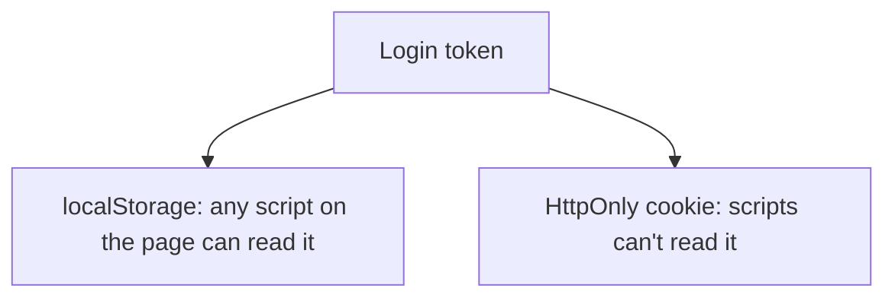
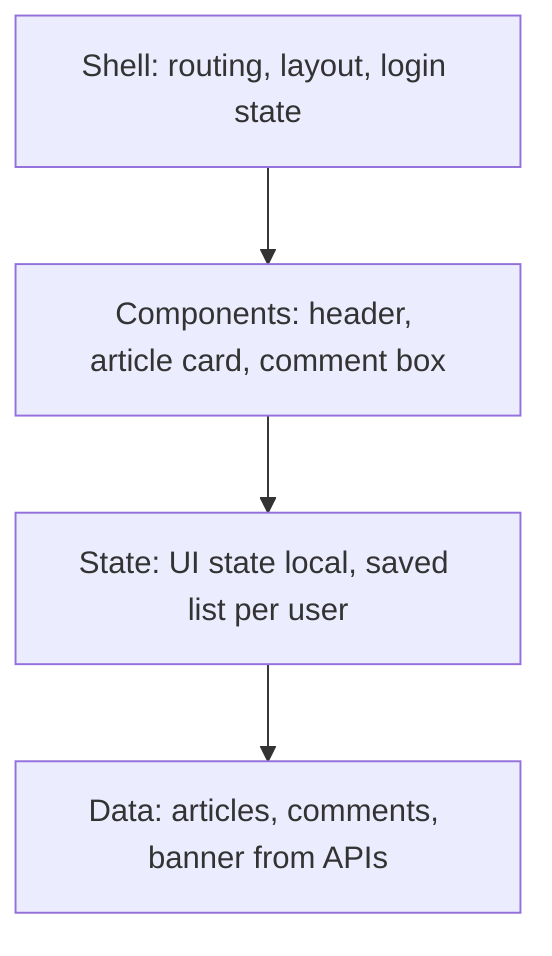

# Security, Access and the Big Picture

Forge · Session 5 · Theory only

<!--
Open with the homework: 3 things to try for a slow home page on weak signal.
Likely answers: send less code, serve static or cached pages, compress images, lazy-load below the fold.
Ask for the cost of each.
-->

---

# Recap in 30 seconds

- Four layers: shell, components, state, data
- Rendering, state, caching, performance, reliability, scaling

Today: **keep users safe, include everyone, then design something together.**

---

# Why the frontend is a risky place

The code runs on the user's device, where **we don't control the environment**.

- Anyone can open the browser tools and look
- Attackers can try to inject their own code
- Secrets in frontend code are not secret

<!--
Analogy: a shop window. Everyone can see inside, so don't leave the safe in the window.
-->

---

# The classic attack: XSS

Cross-site scripting: an attacker gets **their code to run inside our page**.

How it often starts: untrusted text (a comment, a profile name) is shown as if it were code.

Impact: stealing data, acting as the user.

---

# Defences against XSS

| Defence | Plain meaning |
| --- | --- |
| Escape user content | Show it as text, never run it |
| Content Security Policy | Tell the browser which scripts are allowed |
| Careful with raw HTML | Avoid inserting it unless truly needed |

No design is "fully secure". Name the threats and the leftover risks.

---

# Where do we keep the login token?

| Choice | Benefit | Cost |
| --- | --- | --- |
| localStorage | Simple | An XSS attack can steal it |
| HttpOnly cookie | Safer from XSS | Needs extra care against cross-site requests |

<!--
Keep it honest: neither is magic. Say the trade-off out loud.
-->

---

# Accessibility is design, not decoration

Some users rely on a keyboard, a screen reader, or larger text.

Building for them also helps:

- People with a broken arm or bright sunlight
- Everyone who likes fast keyboard use
- Search engines

---

# Accessibility basics

- Use meaningful HTML (real buttons, real headings)
- Everything works with the keyboard alone
- Move focus sensibly when a popup opens or the page changes
- Describe images and announce updates for screen readers
- Don't rely on colour alone

<!--
Practical test for the room: put your mouse aside and try to use any site with only Tab and Enter.
-->

---

# Privacy and consent

Laws like GDPR affect how a frontend behaves:

- Don't load tracking until the user agrees
- Collect only what you need
- Let people see and delete their data

Design the app so it **still works** if the user says no.

---

# The 4-step method, one more time

1. **Clarify:** users, scale, devices, search needs
2. **Requirements:** what it does, how well
3. **Sketch** the four layers
4. **Deep dive** 2 or 3 decisions with trade-offs

Now we use it.

---
layout: center
class: text-center
---

# Worked example

## Design a news app

We'll do it together. I'll draw, you decide.

---

# Step 1: Ask questions

Take answers from the room:

- Who reads it, and on what devices?
- How many people at once on a big news day?
- Must Google find articles?
- How fast must breaking news appear?
- Can users log in, comment, save?

<!--
Write the answers on the board. Invent reasonable ones if the room is quiet:
mostly phones, spikes on big stories, SEO critical, breaking news within a minute.
-->

---

# Step 2: Requirements

| What it does | How well |
| --- | --- |
| Browse and read articles | First view under 2.5s on a phone |
| Comment and save (logged in) | Article readable even if comments fail |
| Breaking news banner | Fresh within about a minute |
| Search | Works with screen readers and keyboard |

---

# Step 3: Sketch the layers

Ask: which layer will cause us the most trouble?

---

# Step 4a: Rendering (Session 2)

| Page | Choice | Why |
| --- | --- | --- |
| Home | Static + frequent refresh (ISR) | Fast, findable, fresh enough |
| Article | Static or server-side | SEO and speed |
| Comments | Client-side | Changes constantly |
| Saved articles | Client-side | Private, per user |

Cost: a mix means more moving parts.

---

# Step 4b: Data and caching (Session 3)

- Fetch the article and comments **in parallel**
- Article: cache a lot (changes rarely)
- Comment count: cache briefly
- Breaking banner: very short cache, or push updates
- "Like": optimistic, with undo on failure

Cost: some content may be a few seconds old.

---

# Step 4c: Performance and reliability (Session 4)

- Load only the code for the page being viewed
- Resize and compress images, load below-the-fold ones later
- Comments or recommendations fail? Hide with a small notice
- Measure with real-user data

Cost: extra build tooling and monitoring.

---

# Step 4d: Safety and access (today)

- Escape all comment text (stops XSS)
- Content Security Policy in place
- Login token in an HttpOnly cookie
- Keyboard and screen reader tested
- Consent before analytics

Cost: more care in every feature.

---

# Say the trade-offs

Pick one decision and say it in full:

> "I chose X because Y matters most here. The cost is Z, and if W changed I'd reconsider."

Volunteers, anyone?

---

# What we covered in the series

| Session | Topic |
| --- | --- |
| 1 | Layers and how to start |
| 2 | Rendering strategies |
| 3 | State, data, caching |
| 4 | Performance, reliability, scale |
| 5 | Security, access, worked example |

---

# What next?

- Practical sessions: build parts of this app together
- Pick the topic you want next (short poll in the group)
- Notes and slides are published in our GitHub repo

---

# Please give feedback

Two minutes:

- What was clear?
- What was confusing?
- What should we do next?

Honest answers help us improve every session.

---
layout: center
class: text-center
---

# Questions?

Source inspiration: System Design Handbook, "Frontend System Design" guide.
These slides are our own words.

Forge · join, learn, build
